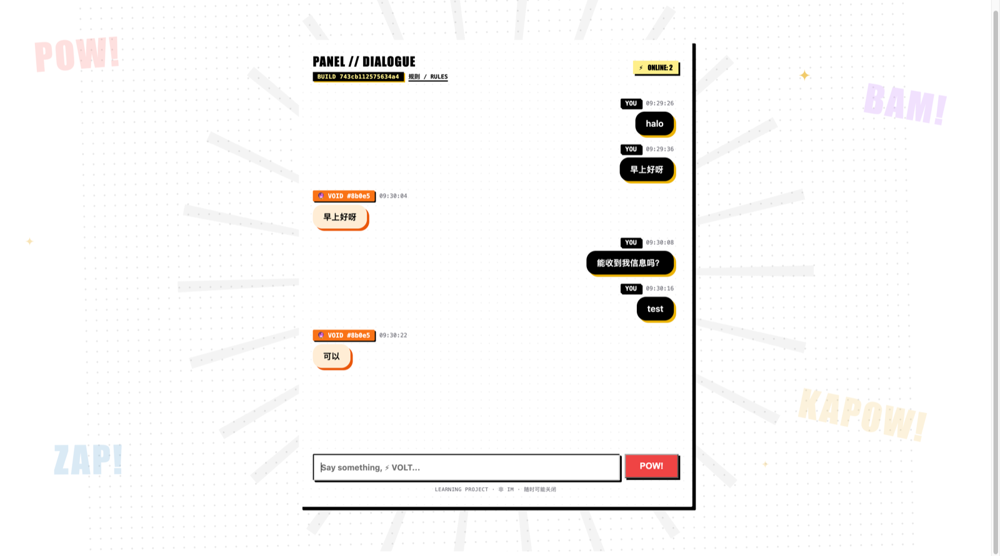

# comic chat

> 这是一个**个人学习 / 工程实验项目**，不是 IM 或社交产品：没有 SLA、没有用户增长目标，
> 随时可能关闭。它用来验证 WebSocket 广播、断线补发、单二进制交付等工程问题。

一个 Go + React 的实时通信实验：WebSocket 消息、在线人数、输入状态，前端构建产物用
`go:embed` 打进二进制，**交付物就是一个可执行的单文件**。



<sub>公开演示：<https://comic.selena.ink> · <a href="https://comic.selena.ink/rules.html">规则页</a> · 学习项目，不是 IM 产品</sub>

## 结构

```
main.go                 组合根：embed SPA、env、信号、http.Server 生命周期
debug.go                pprof + /debug/stats（仅 DEBUG_ADDR 时启用）
internal/chat/          聊天领域逻辑，外部无法 import
  hub.go                  连接注册 / 广播 / 历史快照 / 心跳 / 批量写
  routes.go               HTTP 路由装配（/ws、/healthz、SPA 回退）
  session.go              身份：cookie 签发校验、昵称派生（不可变）
  state.go                持久化：签名密钥（0600，原子创建）
  history.go              消息持久化：SQLite（纯 Go 驱动）+ 批量事务写入
  roles.go                角色池（服务端唯一来源）
cmd/loadtest/           压测器（独立可执行）
web/                    React 19 + StyleX，构建到 web/dist
  public/rules.html       公开房间的社区规则 / 隐私说明
  src/App.tsx             容器：输入 / 发送 / 上传 / 页面组合
  src/chat/components/    PanelHeader、MessageStream、MessageRow、Composer 等展示组件
  src/chat/hooks/         useChatSocket、useChatScroll、useHistoryPagination、useAutoReload、useComicFx
  src/chat/               types / constants / messages / theme / styles
Makefile                make check / build / run / loadtest
deploy.sh               构建并部署（服务器地址从环境变量读取）
docs/screenshot.png      界面截图（README 展示用）
Dockerfile              多阶段构建：前端 → Go 静态二进制 → distroless nonroot
.github/workflows/      CI：make check + make build
```

`internal/` 是编译器强制的边界：`internal/chat` 只能被 `github.com/ieuforu/comic` 之下的代码导入，
将来即使把这个模块当依赖引入，也无法越过它。`main.go` 只做装配，不含业务逻辑。

## 本地运行

```bash
make check      # gofmt + vet + race 测试
make run        # 构建前端 + 二进制并启动 :8080
```

开发前端时用 Vite 代理到本地 Go 服务（`/ws`、`/api` → `localhost:8080`）：

```bash
go run .            # 终端 1
cd web && pnpm dev  # 终端 2，:5173
```

## 构建与部署

```bash
DEPLOY_HOST=root@your-server ./deploy.sh
```

脚本会构建前端、交叉编译 Linux 二进制（`CGO_ENABLED=0`，静态链接）、上传并重启
systemd 单元。服务器地址、部署路径、单元名都通过环境变量传入，仓库里不保存任何主机信息。

### 部署后前端自动更新

二进制启动时会遍历嵌入的 `web/dist` 计算 buildId，注入 `index.html` 的
`<meta name="app-build">`，并随 WebSocket `snapshot` 下发。已打开的页面在重连时比较
两个 id：不一致就进入更新流程——输入框为空且没有上传时约 1 秒后自动刷新；有草稿则等
发送/清空后刷新，草稿存在 `sessionStorage`，刷新后恢复。

`index.html` 返回 `Cache-Control: no-store`，`/assets/*`（Vite 带 hash）返回
`immutable`，避免刷新后仍拿到旧 shell，或新旧 chunk 混用。

> 首次上线这个机制前已经打开的页面没有 `app-build` meta，且旧 `index.html` 可能还被
> 浏览器缓存，需要手动**硬刷新**一次（Cmd/Ctrl+Shift+R）；之后部署都会自动处理。

## 身份

身份完全由服务端决定，客户端只能"被分配"：

1. 首次访问 `GET /api/session` → 服务端签发 **httpOnly + SameSite=Lax** 的 `sid` cookie，
   值是 `sessionId.HMAC-SHA256` 签名，无法伪造；有效期 180 天
2. WebSocket 握手必须带这个 cookie，否则 `401`（不再有"匿名随便进"）
3. 每条上行消息的 `sender` / `clientId` 一律由服务端按会话覆盖，客户端传什么都不算
4. **`online` = 去重后的人数，`connections` = 连接数**——同一浏览器开三个标签是 1 个人、3 条连接
5. 昵称默认由 `sessionId` 确定性派生，客户端**无法**修改；但**运营者可以指定**（见下）

### 运营者指定昵称

`STATE_DIR/names.json` 由你手写，服务端**改了文件就生效**（每 2 秒检查一次 mtime，
不用重启、不用重新构建）：

```json
{
  "names": {
    "b9f48": "张三",
    "a1b2c3d4e5f60718293a4b5c6d7e8f90": "李四"
  }
}
```

- key 可以是 **5 位会话前缀**（就是界面上显示的 `#b9f48`），也可以是**完整 32 位 session id**
- value 是显示名；emoji 与配色仍由会话派生，所以同一个人风格不变
- 删掉某条或清空对象 → 该会话回落到派生默认名
- 改名会广播 `profile` 事件，**被改名的人自己也不用刷新页面**（其他人本来就在下一条消息里看到新名字）
- 历史消息的 `sender` 在**读取时**按 `session_id` 重新派生（snapshot 和 `/api/history` 都会），
  所以改名会作用于旧消息；数据库里仍保留写入时的 `sender` 作为无 session_id 的兼容回退，
  不需要批量 `UPDATE`，也没有额外 IO
- 文件写坏了（比如保存到一半）→ **保留上一版映射**，不会把所有人名字清空

### 一个身份能保持多久

| 场景 | 身份是否变化 |
|---|---|
| 同一标签刷新 | 不变 |
| 同一浏览器开多个标签 | 不变（同一 cookie；人数统计按人去重） |
| 关闭浏览器后重开（180 天内） | 不变 |
| **服务重启 / 重新部署** | **不变**（签名密钥持久化在 `STATE_DIR`） |
| 清除 cookie / 无痕窗口 / 换浏览器或设备 | 变成新身份（无账号体系时的固有限制） |

持久化细节：

- **身份不可变**：昵称由 `sessionId` 派生，任何 API 都无法修改它；`POST /api/session/name` 已移除
- **签名密钥**：优先 `SESSION_SECRET`，否则自动生成并写入 `STATE_DIR/session-secret`（0600）
- **运营者昵称**：`STATE_DIR/names.json`，热加载；文件缺失时自动生成空模板
- **`STATE_DIR` 解析顺序**：环境变量 → `./.state` → **可执行文件同级的 `.state`**
  （最后一条很重要：systemd 的工作目录常是 `/`，相对路径建不出来就会丢密钥，导致每次重启换身份）
- 默认昵称由 `sessionId` 确定性派生；只要 `session-secret` 还在，同一 cookie 永远是同一个身份

## 协议

WebSocket `/ws`，单一 JSON 事件契约：

| type | 方向 | 说明 |
|---|---|---|
| `chat` | C→S→C | 文本消息，服务端分配递增 `seq` 并保留最近 50 条 |
| `snapshot` | S→C | 连接建立时下发历史、人数、连接数、最新 `seq`、前端 `buildId`；带 `?since=` 时只下发缺失部分，`truncated` 表示已被淘汰 |
| `presence` | S→C | 人数 / 连接数变化 |
| `typing` | C→S→C | 输入状态，不进入历史 |
| `profile` | S→C | 运营者改了昵称，携带 `clientId`（会话前缀）与新的显示名 |
| `delete` | S→C | 运营者删除了某条消息，携带 `seq`；客户端立即从列表移除 |

## 配置

| 环境变量 | 默认 | 说明 |
|---|---|---|
| `ADDR` | `:8080` | 监听地址 |
| `ALLOWED_ORIGINS` | 空（仅同源） | 逗号分隔的额外允许来源 |
| `SESSION_SECRET` | 空 → 自动生成并保存 | cookie 签名密钥；不设也能跨重启保持，显式设置便于多实例共享 |
| `ADMIN_TOKEN` | 空（管理接口关闭） | 设置后才启用 `POST /api/admin/delete`，请求头 `X-Admin-Token` |
| `STATE_DIR` | `./.state` | 运行状态目录：`session-secret` 与 `history.db`，需可写 |

## 已加固

- **`go test -race` 覆盖**：广播、历史截断、presence、并发连接churn、优雅关闭、Origin 校验
- **优雅关闭**：`SIGTERM` → 给所有客户端发 close 帧（1001）→ `srv.Shutdown` → 退出；WebSocket 是
  hijacked 连接，`srv.Shutdown` 不会等它们，必须由 Hub 主动关闭（`go test -race` 抓到的正是
  "Run 与 writePump 同时写同一个 conn" 这个竞争）
- **Origin 白名单**：默认只接受同源握手，`ALLOWED_ORIGINS` 可追加；非浏览器客户端（无 Origin 头）放行
- **`ReadHeaderTimeout` / `IdleTimeout`**：防慢速连接耗尽监听器
- **`/healthz`** 供 systemd / 负载均衡探活
- **身份来自服务端会话**：httpOnly + SameSite=Lax 的 HMAC 签名 cookie；`sender` 由服务端注入，
  客户端无法冒充；`online` 按人去重、`connections` 单独统计

## 断线重连

1. 每条 `chat` 由服务端分配递增 `seq`，快照里带最新 `seq`
2. 客户端记录见过的最大 `seq`，重连时带 `?since=<seq>`
3. 服务端只回放 `seq` 之后的消息；若这段已被 50 条上限淘汰，快照带 `truncated: true`
4. 客户端按 `seq` 去重（补发与实时可能重叠），并显示“重连中…”
5. 重连使用**指数退避 + 随机抖动**（0.5s 起、上限 30s、±50% 抖动）——服务重启时
   所有客户端同时重连会打满监听队列（`somaxconn` 默认 128），抖动是必须的，不是优化

## 历史分页与滚动

内存里的 `snapshot` 仍然只带最近 50 条，但数据库保留了最近 2000 条。更早的消息通过
HTTP 分页读取：

```
GET /api/history?before=<seq>&limit=50      # 需要会话 cookie
→ { "messages": [...升序...], "hasMore": true }
```

- 前端滚动到顶部附近时自动加载上一页，前插时用滚动高度差保持当前视口不动；顶部也有
  手动「加载更早的消息」按钮和失败重试。
- 消息列表用浏览器原生 `content-visibility: auto` 跳过离屏渲染（DOM 仍保留，便于
  浏览器查找/无障碍），不是引入虚拟列表库的窗口化实现。
- 收到新消息时，只有当前已经在底部附近（80px 内）才跟随；否则显示「N 条新消息 ↓」，
  点击平滑回到底部。自己发消息会主动回到底部。
- 数据库只保留最近 2000 条，再早的消息无法回看。

## 管理删除

设置 `ADMIN_TOKEN` 后启用一个最小管理接口：

```bash
curl -X POST https://your-host/api/admin/delete \
  -H "X-Admin-Token: $ADMIN_TOKEN" \
  -H "Content-Type: application/json" \
  -d '{"seq": 123}'
```

服务端会同时从内存历史、SQLite 和关联图片中删除，并广播 `delete` 事件让在线页面立即移除。
未设置 `ADMIN_TOKEN` 时接口不存在（404）。删除不会回填 `seq`，后续消息编号继续递增。

## Docker

```bash
docker build -t comic-chat .
docker run --rm -p 8080:8080 -v comic-data:/data comic-chat
```

镜像使用 distroless nonroot，`STATE_DIR=/data` 是唯一需要持久化的卷。

## 社区规则与关闭

- 公开房间的规则页：`/rules.html`，面板顶部有「规则 / RULES」入口。
- 需要立即下线时：
  ```bash
  systemctl stop comic      # 立即停止服务（Caddy 会返回 502）
  systemctl disable comic   # 可选：禁止开机自启
  ```
  重新开放用 `systemctl start comic`。停服前如需保留现场，先备份 `STATE_DIR`。

## 图片消息

`Ctrl+V` 粘贴即可发送，图片**走 HTTP 上传，不进 WebSocket**（每个 WS 帧只有 512 字节上限，
把图片塞进广播扇出会毁掉整个设计）：

```
Ctrl+V → POST /api/upload（带会话 cookie）→ 服务端嗅探字节、校验类型与大小
       → 存盘 + 落库 → 返回 id → 客户端再发一条 type=image 的 WS 消息（内容只是 id）
```

| 项 | 值 |
|---|---|
| 允许类型 | PNG / JPEG / GIF / WebP（**SVG 不收**，它能带脚本） |
| 单张上限 | 5 MB（`MEDIA_MAX_MB` 可调）|
| 保留期 | 7 天（`MEDIA_TTL_HOURS` 可调），到期由后台每小时清理；聊天文字永久保留 |
| 归属校验 | `image` 消息只能引用**自己上传**的图片 |
| 渲染 | 点击图片全屏放大，`Esc` 或点击任意处关闭；过期图片显示「图片已过期」|

服务端不信任 multipart 里的 Content-Type，而是用 `http.DetectContentType` 嗅探前 512 字节；
回包固定 `Content-Type` 并加 `X-Content-Type-Options: nosniff` 与 CSP，避免上传物在本源内被当
HTML/脚本执行。

## 消息持久化

- SQLite（`modernc.org/sqlite`，**纯 Go 实现**，不引入 CGO，保持 `CGO_ENABLED=0` 静态单二进制）
- 表 `messages(seq PRIMARY KEY, session_id, sender, content, time, created_at)`，
  `seq` 直接复用全局序号，重启后**编号接着走**而不是从 1 重来
- 写入是**批量事务**：队列 + 每 32 条或 50ms 提交一次；落盘在独立 goroutine 里，
  不会把磁盘延迟加到广播路径上
- 队列满时**丢弃并计数**，而不是阻塞广播——聊天先活着，比消息一条不落更重要
- 启动时把最近 `maxHistory` 条读回内存，并把数据库裁剪到最近 2000 行（更旧的本来也无法回放）
- 数据库打不开时**降级为仅内存**并在日志里警告，不会让服务起不来

## 频控

每连接一个令牌桶（`golang.org/x/time/rate`），**只限制 `chat`**——`typing` 不限，那条路径本来
就由客户端 debounce。

| 环境变量 | 默认 | 说明 |
|---|---|---|
| `RATE_MODE` | `log` | `log` 只记录不拦截（默认，先观察真实峰值）／`enforce` 丢弃超额并提示／`off` 关闭 |
| `RATE_PER_SECOND` | `5` | 每秒补充的令牌数（5 条/秒 ≈ 300 条/分钟，约为人手速的 10 倍）|
| `RATE_BURST` | `10` | 允许的突发条数（粘贴多行、连点发送）|

超额时（`enforce`）给发送者回一条 `notice` 事件，前端在输入区显示"发送太快了"约 2 秒；
**不会断开连接**。观察模式下只累加计数并写日志。

先跑 `log` 观察几天，拿到真实峰值再切 `enforce`——阈值不该拍脑袋定。

## 已知缺口
- 无账号体系，清 cookie / 换设备即为新身份
- 单机单进程：多实例部署需要跨实例广播（Redis / NATS）
- 频控是"每连接"的：一个人开 10 个标签就是 10 倍额度（身份维度限流需要另一套计数）
